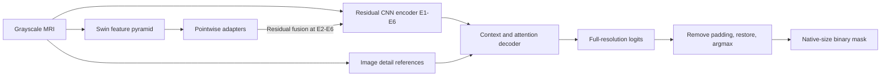
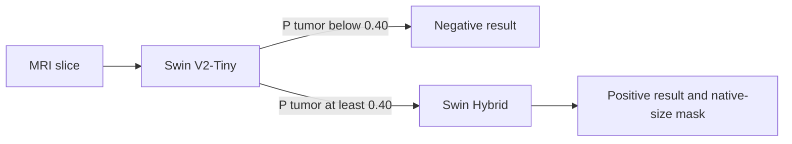

# MRI: Brain Tumor CADx with Swin V2 and Swin Hybrid

Swin Hybrid combines a trainable Swin Transformer with a six-stage nnU-Net residual encoder, multiscale feature fusion, depthwise refinement, and a detail-aware decoder for **binary brain tumor segmentation on 2D MRI slices**. The project includes reproducible training, KAN and depthwise comparison models, and a native **Rust inference application**.

The default Python and Rust pipelines use the final Swin Hybrid EMA weights from epoch 159. The validation-selected EMA from epoch 109 and the historical comparison experiments are documented in the [benchmark archive](docs/benchmarks/README.md).

## Architecture

The model contains **38,801,022 parameters**, all trainable: **1,988,850** in Swin and **36,812,172** in the convolutional backbone, fusion paths, refiners, and decoder. Counts include auxiliary training heads and exclude the separate weight-EMA copy.

| Stage | Spatial size at 512 input | CNN channels | Residual blocks | Fused Swin channels |
|---|---:|---:|---:|---:|
| E1 | 512 × 512 | 32 | 1 | — |
| E2 | 256 × 256 | 64 | 3 | 24 |
| E3 | 128 × 128 | 128 | 4 | 48 |
| E4 | 64 × 64 | 256 | 6 | 96 |
| E5 | 32 × 32 | 320 | 6 | 192 |
| E6 | 16 × 16 | 320 | 6 | 384 |

- **CNN backbone:** `ResidualEncoderUNet` from `dynamic-network-architectures`, 3×3 convolutions, instance normalization, and LeakyReLU. Decoder stages each use two convolutions.
- **Swin branch:** embedding dimension 24, patch size 2×2, window size 7×7, depths `[2, 2, 2, 2]`, and attention heads `[3, 6, 12, 24]`. Projected Swin features enter E2–E6 through learned residual scales.
- **Local refinement:** residual 3×3 depthwise/pointwise blocks at E3–E6.
- **Decoder:** pooled E3–E6 context plus a global descriptor, raw-image detail paths at E1–E3, and residual Efficient Multi-Scale Attention at E3–E5 skips. Two boundary heads provide auxiliary supervision during training.
- **Output:** two logits per pixel, background and tumor. Auxiliary segmentation scales support deep supervision. Inference returns the highest-resolution logits.

The retained pretrained file was a **3D, three-channel Swin checkpoint**. Transfer sums depth and input-channel patch-embedding weights, takes the central depth plane of relative-position biases, and preserves the 8C patch-merging projection using coplanar merging. It loads 126 Swin state tensors with strict checks. Original pretraining data/modalities cannot be established from the file. The transferred encoder is then fully fine-tuned. See [the current architecture/protocol reference](docs/architecture/SWIN_HYBRID.md) and the saved `tokenizer_transfer.json`.



## CADx inference flow

Each grayscale MRI slice goes through Swin Transformer V2-Tiny. A tumor probability below 0.40 returns a negative result immediately. At or above 0.40, Swin Hybrid restores the segmentation logits to the original image size and returns the tumor mask.



```python
from src.pipeline import CADxPipeline

pipeline = CADxPipeline()
result = pipeline.predict("path/to/mri_slice.jpg")
```

```powershell
python -m src.pipeline --image path/to/mri_slice.jpg --output-json report.json
```

The Python pipeline reads `outputs/checkpoints/classifer_swinv2_tiny/classifer_swinv2_tiny_binary.pt` and the saved evaluation weights in `outputs/checkpoints/swin_hybrid_512_unfrozen_seed2026/last.pt`. On a positive slice, `stage2_segmentation` contains the mask, tumor area and bounding box. On a negative slice, it is `None`.

The [Kaggle training notebook](notebooks/Kaggle_SwinV2_Classifier.ipynb) writes the classifier checkpoint under `/kaggle/working/outputs/checkpoints/classifer_swinv2_tiny/`. Copy the checkpoint into the matching project directory for local inference. The local trainer (`python -m src.models.swin_classifier`) uses the same project directory by default. Use `--output` to train into a separate directory when a checkpoint already exists.

## Inference checkpoints

This repository stores the default inference weights in Git LFS. After cloning with Git LFS installed, run `git lfs pull` if the weights are still pointer files. Python uses the classifier PT, Swin Hybrid epoch 159 `last.pt`, and `Brain_Swin_UNETR.pth`. Rust uses the classifier and epoch 159 ONNX graphs and their adjacent checksum JSON files.

## Rust desktop inference UI

From the project root, build and launch the desktop interface. The local Python command locates the ONNX Runtime DLL installed with the development dependencies. You can also pass the DLL's path directly.

```powershell
cargo build --release --locked --features gui --manifest-path inference/Cargo.toml
$ortDll = python -c "import pathlib,onnxruntime; print(pathlib.Path(onnxruntime.__file__).parent/'capi'/'onnxruntime.dll')"
.\inference\target\release\brain-inference.exe --gui --ort-dylib $ortDll
```

Use **Kịch bản** to select one of four labeled BRISC test slices or **Mở ảnh JPG/PNG** to open a custom image. The top row shows the preprocessed input and the screening result, with a red overlay when the segmenter predicts tumor pixels. The bottom row shows the original and, for built-in cases, the BRISC label and green reference overlay. The three tumor types in the dropdown describe reference labels. Inference predicts tumor presence and a binary mask. **Bật CLAHE** applies an 8×8 tile contrast enhancement to the grayscale image before both models and defaults to off.

The tumor examples were selected for irregular boundaries and Dice above 0.80. The no-tumor example has strong within-tissue intensity gradients. In the Rust CPU check, all four matched the binary screening label. Glioma, meningioma and pituitary had Dice **0.8897, 0.9375 and 0.9078** with CLAHE off and **0.8177, 0.9275 and 0.8718** with CLAHE on. These are selected demonstration cases.

## Project layout

```text
configs/
  dataset/                # BRISC source, local root, preprocessing, split
  model/                  # Backbone/head specifications and model options
    plans/                # nnU-Net-compatible architecture JSON fragments
  trainer/                # Optimizer, cosine schedule, epochs, EMA, stopping
  default.yaml            # Swin Hybrid
  kan.yaml
  depthwise.yaml
data/
  data/brisc2025/          # Original local dataset; excluded from Git
  processed/              # Optional derived data
notebooks/
  Kaggle_SwinV2_Classifier.ipynb # Standalone Kaggle training notebook for Swin Classifier
src/
  __init__.py
  core/                   # Registry, YAML/JSON composition, portable paths
  datasets/               # BRISC dataset and Kaggle download
  models/                 # Swin Hybrid, Swin Transformer V2-Tiny classifier, comparison architectures
  pipeline/               # Two-stage CADx end-to-end inference pipeline
  trainers/               # Training loops, loss, EMA, legacy policy utilities
  utils/                  # Metrics and evaluation utilities
scripts/                  # Download, evaluation, export, profiling, verification
outputs/
  checkpoints/<run>/      # best.pt and last.pt
  checkpoints/classifer_swinv2_tiny/ # Classifier checkpoint and ONNX export
  checkpoints/pretrained/ # Original Brain Swin initialization
  checkpoints/exports/    # ONNX graph and checksum/epoch metadata
  logs/<run>/             # Training history.jsonl and diagnostic logs
  runs/<run>/             # Config, splits, metrics, per-image results, status
inference/
  Cargo.toml
  Cargo.lock
  src/*.rs                # Entire inference application is written in Rust
tests/
docs/                     # Architecture, benchmark evidence, archived notes
third_party/              # Preserved reference repositories and their licenses
requirements.txt
requirements-dev.txt
pyproject.toml
train.py
```

New runs use `outputs/runs/<timestamp>_<model>` automatically, with matching directories under `outputs/checkpoints` and `outputs/logs`. An explicit `--output outputs/runs/my_run` selects a stable run name. Custom output folders outside a `runs` directory store their `checkpoints/` and `logs/` inside that folder. Existing checkpoints/history are protected from accidental fresh-run overwrite.

## Installation

Run commands from the project root. Python 3.10+ is declared; the verified local environment is **Python 3.14.2, PyTorch 2.10.0+cu130, MONAI 1.6.1, Windows, and an NVIDIA RTX 3060 12 GB**.

```powershell
python -m venv .venv
.\.venv\Scripts\Activate.ps1
# Install a CUDA-enabled PyTorch build using the official selector first.
python -m pip install -r requirements.txt
python -m pip install -e . --no-deps
# Development, test, and ONNX export dependencies:
python -m pip install -r requirements-dev.txt
```

Use the [official PyTorch installation selector](https://pytorch.org/get-started/locally/) for your operating system and CUDA environment. The Windows launchers select `.venv/Scripts/python.exe` when available and propagate the training exit code.

## Dataset

Source: [BRISC 2025 on Kaggle](https://www.kaggle.com/datasets/briscdataset/brisc2025). The existing dataset has been moved to `data/data/brisc2025` without altering its images or masks. When it is absent, the default configuration downloads it with [KaggleHub](https://github.com/Kaggle/kagglehub). Dataset access may require Kaggle authentication/consent.

```powershell
python -m scripts.download_data
python train.py --print-config
```

Expected segmentation layout:

```text
data/data/brisc2025/segmentation_task/
  train/images/   train/masks/
  test/images/    test/masks/
```

There are **3,933 paired training images** and **860 paired test images**. A seed-2026 split stratified by tumor type and imaging plane gives **3,146 fitting / 787 validation** images. These are slice-level splits; patient IDs are unavailable. The end-to-end test adds 140 no-tumor images from the classification split. The evaluator verifies that the 860 tumor images are byte-identical across both splits.

Images become grayscale, are resized with aspect-preserving bilinear interpolation and centered padding, and are normalized using the nonzero pixels of each slice. Foreground masks use `mask >= 128`. Padded target pixels are ignored. Evaluation removes padding, restores continuous logits to native image size, then applies argmax. Tumor-type scores group slices by filename labels; the network predicts a single binary tumor class.

## Training

```powershell
# Default Swin Hybrid experiment, with automatic timestamped output
python train.py
# Equivalent Windows launcher
.\run_hybrid.bat

# Comparison models
python train.py --model kan
python train.py --model depthwise

# Explicit configuration and CLI overrides
python train.py --config configs/default.yaml --batch-size 1 --effective-batch 16
python train.py --config configs/kan.yaml --epochs 100 --workers 4

# Two-epoch functional check, including delayed EMA at epoch 2
python train.py --smoke-test --size 64 --batch-size 1 --effective-batch 2 --ema-start 2

# Resume the retained Swin run with its original training budget/protocol
python train.py --resume outputs/checkpoints/swin_hybrid_512_unfrozen_seed2026/last.pt
```

The retained Swin run has already reached its early-stopping condition. Resuming restores its state and evaluates the selected checkpoint; it does not extend the original budget or reset early stopping. Fresh experiments receive new timestamped destinations. Resume options affecting the protocol must match the checkpoint. To resume the historical KAN run, preserve its original 100-epoch budget, four workers and weighted-mIoU selection:

```powershell
python train.py --model kan --epochs 100 --workers 4 --selection-metric weighted-miou --resume outputs/checkpoints/kan_20261101_090911_204358/last.pt
```

The configuration loader supports `.yaml`, `.yml`, and `.json`, with relative section includes under `defaults`. CLI options override configuration values. Dataset split seed/fraction live in `configs/dataset`; optimizer, LR schedule and training controls live in `configs/trainer`. Model YAML documents the fixed checkpoint architecture; supported tunable model options live under `model.options`. Changing the audited Swin topology requires corresponding model code and a fresh checkpoint.

| Swin training setting | Value |
|---|---|
| Input / physical / effective batch | 512×512 / 2 / 16 |
| Optimizer | AdamW, weight decay 0.0001, gradient clipping 12 |
| Initial CNN / Swin LR | 0.0003 / 0.00009 |
| LR schedule | Shared cosine multiplier to 1% of initial LR |
| Maximum epochs | 300; actual completed epochs: 159 |
| Weight EMA | Starts at epoch 20, decay ceiling 0.9995 |
| Early stopping | After epoch 100, patience 50, minimum delta 0.0001 |
| Checkpoint selection | Validation Glioma mean foreground IoU |
| Tumor sampling weights | Glioma 2.0, Meningioma 1.0, Pituitary 1.3 |
| Augmentation / precision | Robust augmentation, all tumor types / CUDA AMP |
| Reserved-memory budget | 9 decimal GB, measured through PyTorch |

The deep-supervision objective is `alpha * Dice + beta * Focal + gamma * Boundary`. For progress `p = clamp((epoch - 1) / 149, 0, 1)`, alpha is 1, beta is `0.5 + 0.5p`, and gamma is `0.01 + 0.49p`. Losses ignore padding. Weight EMA is separate from Efficient Multi-Scale Attention and advances only after successful optimizer updates. Resume checkpoints include model, EMA, optimizer, scheduler, AMP scaler, splits, RNG, early stopping, and the current history row.

## Test results

Both tests use the Swin Hybrid epoch 159 EMA checkpoint and evaluate masks at native resolution. mIoU and Dice are per-image means. HD95 and ASSD are measured in pixels, and NSD uses a two-pixel tolerance.

### Segmentation model

Swin Hybrid ran on all 860 paired tumor slices using PyTorch CUDA AMP with batch size 2. [Local report](outputs/runs/cadx_segmenter_epoch159/test_metrics.json)

| Test subset | Images | mIoU | Dice | HD95 (px) | ASSD (px) | NSD |
|---|---:|---:|---:|---:|---:|---:|
| All tumor slices | 860 | **0.81146** | **0.87722** | 16.29043 | 4.68427 | 0.75194 |
| Glioma | 254 | 0.70489 | 0.78904 | — | — | — |
| Meningioma | 306 | 0.90494 | 0.94662 | — | — | — |
| Pituitary | 300 | 0.80634 | 0.88108 | — | — | — |

### Full CADx system

The Python inference pipeline ran in FP32 on CUDA with batch size 1. The test includes 860 paired tumor slices and 140 no-tumor slices with empty reference masks. An empty prediction paired with an empty reference scores 1 for IoU and Dice. [Local report](outputs/runs/cadx_system_epoch159/test_metrics.json)

| Test subset | Images | Segmenter runs | mIoU | Dice | Nonempty predictions on no-tumor slices |
|---|---:|---:|---:|---:|---:|
| All slices | 1,000 | 860 | **0.83787** | **0.89442** | 0/140 |
| Tumor slices | 860 | 860 | 0.81148 | 0.87723 | — |
| No-tumor slices | 140 | 0 | 1.00000 | 1.00000 | 0/140 |

## Rust inference

All inference application source files are Rust. The Python **export utility lives in `scripts/`**, alongside training tooling. Export both models to ONNX once so the Rust application can run with ONNX Runtime. The default segmenter uses **EMA epoch 159**.

```powershell
# Regenerate only if the ONNX files are absent
python -m scripts.export_swin_classifier
python -m scripts.export_swin_hybrid

# Build with stable Rust; tested with rustc/cargo 1.96.1
cargo build --release --locked --manifest-path inference/Cargo.toml

# During setup, locate the CPU ONNX Runtime library installed with requirements-dev
$ortDll = python -c "import pathlib,onnxruntime; print(pathlib.Path(onnxruntime.__file__).parent/'capi'/'onnxruntime.dll')"

.\inference\target\release\brain-inference.exe --input data/data/brisc2025/segmentation_task/test/images/brisc2025_test_00001_gl_ax_t1.jpg --output outputs/runs/predictions_example --ort-dylib $ortDll
```

`--input` accepts one JPEG/PNG or a flat directory of images. Masks are native-size PNGs with 0 for background and 255 for tumor. A negative slice gets an empty PNG and skips the segmenter. Per-image JSON records the screening result, whether segmentation ran, model weights, dimensions, foreground count and timing. The application checks both ONNX files against their adjacent JSON checksums and rejects existing output filenames. Deploy the executable with both ONNX/JSON pairs and a compatible ONNX Runtime library. Use `--classifier` to select another classifier export or `--segment-only` for segmentation benchmarks. `--ort-dylib` also accepts `libonnxruntime.so`/`.dylib`; alternatively configure `ORT_DYLIB_PATH`.

To deploy the validation-selected checkpoint instead:

```powershell
python -m scripts.export_swin_hybrid --checkpoint outputs/checkpoints/swin_hybrid_512_unfrozen_seed2026/best.pt --output outputs/checkpoints/exports/swin_hybrid_epoch109.onnx
# Pass --model outputs/checkpoints/exports/swin_hybrid_epoch109.onnx to the Rust executable.
```

The export fixes input shape to `[1, 1, 512, 512]` and outputs float32 logits `[1, 2, 512, 512]`. Equivalent fixed pooling replaces adaptive context pooling only in the export copy. The exporter checks ONNX validity and real-image logit parity. The verified export had maximum absolute logit error **0.0004573** and **100% argmax agreement** against float32 PyTorch on that image.

Native Rust preprocessing/restoration was checked on five PNG cases, including non-square upsampling/downsampling: maximum input error was below **5e-7** and restored masks matched exactly. A JPEG case matched **99.9981%** of native mask pixels; independent JPEG decoders introduce rounding near zero before nonzero-pixel normalization. This functional check is separate from the 860-image PyTorch accuracy benchmark. See [parity results](outputs/runs/rust_parity_verified/parity.json).

CPU inference is verified using ONNX Runtime **1.24.4**. CUDA inference is available with `cargo build --release --features cuda --manifest-path inference/Cargo.toml` and `--device cuda`; its build was checked, but its runtime was not measured here. Supply an ONNX Runtime GPU build and compatible CUDA/cuDNN libraries following the [official CUDA provider compatibility guide](https://onnxruntime.ai/docs/execution-providers/CUDA-ExecutionProvider.html).

## Recommended hardware

For the documented training configuration, use an **NVIDIA CUDA GPU with 12 GB VRAM or more**; the tested reference is an [RTX 3060 12 GB](https://www.nvidia.com/en-us/geforce/graphics-cards/30-series/rtx-3060-3060ti/). This is a recommendation based on the retained experiment and measured memory, not a minimum proven for every environment. Start Swin with physical batch 2/effective batch 16; reduce the physical batch to 1 if memory is constrained. KAN's retained batch-32 training reserved substantially more memory than this Swin configuration. Keep system RAM available for workers and checkpoint loading; reduce workers on constrained Windows hosts. CPU Rust inference is supported for deployment without a CUDA GPU.

## Reproducing the tests

```powershell
# Choose fresh output directories for repeated evaluations.
python -m scripts.evaluate_checkpoint --checkpoint outputs/checkpoints/swin_hybrid_512_unfrozen_seed2026/last.pt --output outputs/runs/cadx_segmenter_repeat
python -m scripts.evaluate_hybrid_checkpoint --checkpoint outputs/checkpoints/swin_hybrid_512_unfrozen_seed2026/last.pt --output outputs/runs/cadx_system_repeat --include-no-tumor --classifier-checkpoint outputs/checkpoints/classifer_swinv2_tiny/classifer_swinv2_tiny_binary.pt

python -m pytest -q
cargo test --locked --manifest-path inference/Cargo.toml
python -m scripts.verify_rust_inference --output outputs/runs/rust_parity_repeat
```

Reorganization verification passed **129 Python tests**, **3 Rust tests**, two CUDA Swin smoke epochs, a separate depthwise smoke run, and Swin checkpoint resume. Original experiment checkpoint bytes were preserved and verified by SHA-256. Smoke model binaries were removed after verification. The checkpoint inventory is [outputs/checkpoints/manifest.json](outputs/checkpoints/manifest.json); cleanup details and validation logs are under `outputs/logs/reorganization`.

Retained experiment families are **Swin Hybrid 512/unfrozen**, **KAN 20261101**, and the highest-scoring **depthwise 7×7**. Verification, KAN two-way, BiRef, Swin 300/frozen, epoch-58 and lower-scoring depthwise checkpoint binaries were removed. Compact historical reports remain under `docs/benchmarks/historical`; prior architecture notes are explicitly archived. Original checkpoint/config provenance may contain the former paths; current loaders resolve the relocated data and pretrained initialization without rewriting the saved weights.

## Team and citation

**Members:** Tran Manh Hung, Nguyen Phuoc Toan, Nguyen Huu Tuan Phat.
**Mentor:** Hoang Thi Kieu Anh.

If you use this code, architecture or checkpoints, please cite this project using [CITATION.cff](CITATION.cff), and cite the BRISC dataset and upstream methods as appropriate. This is a software citation; no paper DOI or repository URL has been assigned here.

```bibtex
@software{tran2026swinhybrid,
  author = {Tran, Manh Hung and Nguyen, Phuoc Toan and Nguyen, Huu Tuan Phat},
  title = {Swin Hybrid for Brain Tumor Segmentation},
  year = {2026},
  version = {0.1.0},
  note = {Project supervised by Hoang Thi Kieu Anh}
}
```

References and acknowledgments: [Swin Transformer](https://arxiv.org/abs/2103.14030), [nnU-Net](https://github.com/MIC-DKFZ/nnUNet), [MONAI](https://github.com/Project-MONAI/MONAI), [Efficient Multi-Scale Attention](https://arxiv.org/abs/2305.13563), [surface-distance](https://github.com/google-deepmind/surface-distance), and [BRISC 2025](https://www.kaggle.com/datasets/briscdataset/brisc2025). Reference repositories retain their own licenses under `third_party/`.


## Streamlit research dashboard

Chạy `python -m streamlit run app.py` hoặc `run_app.bat`. Hướng dẫn chế độ mock/real, checkpoint và workflow: [docs/streamlit_app.md](docs/streamlit_app.md).
