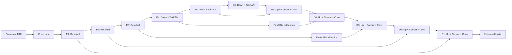

> Historical document from before the 2026-11-03 reorganization. Commands, results and relative paths describe the original workspace. Use the current [README](../../../README.md) for supported commands and retained artifacts.

# Legacy nnUNetResEnc-KAN + two-way context experiments

This document preserves the earlier KAN and two-way designs and measurements. The current default is `depthwise`, described in [README.md](README.md). These older variants remain available explicitly for checkpoint compatibility. The hybrid uses genuine nnU-Net residual convolution blocks at high resolution, grouped Gaussian RBF KAN blocks at low resolution, and FastKAN calibration on the stage 3 and stage 4 skips. `kan-two-way` adds prompt-free two-way attention after encoder stages 4, 5 and 6. KAN stays out of the decoder by default; two low-resolution decoder refinements remain available for an ablation.

The implementation reuses `ResidualEncoderUNet`, `ResidualEncoder`, `BasicBlockD`, and `UNetDecoder` from `dynamic-network-architectures`, the network library used by the local nnU-Net repository. It retains the actual stem, stage 1–3 residual blocks, transpose convolutions, concatenated skips, plain convolution decoder, and deep-supervision interface. Stages 4–6 are replaced. All implementation files are in this folder; the reference repositories are unchanged.

The original saved KAN run's best validation Weighted mIoU is 0.8074, with glioma at 0.7095. The later two-way run's selected validation Weighted mIoU is 0.8033, with glioma at 0.6915. Both miss the glioma mIoU objective of 0.80. Smooth-looking boundaries alone do not identify the cause of the plateau. Synthetic measurements below show computational cost; they do not establish an accuracy improvement.

## Dataset contract

The local `dataset/brisc2025/README.md` describes the overall classification collection as 6,000 images. Inspection of the segmentation manifest **and actual folders** gives a different segmentation subset:

| Split | Image/mask pairs | Glioma | Meningioma | Pituitary |
|---|---:|---:|---:|---:|
| Train | 3,933 | 1,147 | 1,329 | 1,457 |
| Test | 860 | 254 | 306 | 300 |

Actual paths are `segmentation_task/{train,test}/{images,masks}`. No `nt` images appear in this segmentation subset. Classification labels are image-level tumor types; the segmentation target is **binary tumor foreground**, not four tumor subregions or a four-class pixel map.

- Input: float tensor `[B,1,H,W]`, using grayscale MRI. Normalize images consistently; normalization inside the network does not replace image preprocessing.
- Target: integer tensor `[B,H,W]`, background `0`, tumor `1`. Sampled 8-bit masks contain values near 0 and 255, including `1..7` and `248..254`. Convert to binary using `mask >= 128`; using `mask > 0` would label low-valued pixels as tumor. This assumes the supplied masks retain their observed 8-bit encoding. Resize labels with nearest-neighbor interpolation.
- Output: two **raw logits**, `[B,2,H,W]`. Use CE + foreground Dice during training; use `softmax(dim=1)[:,1]` or `argmax(dim=1)` during inference. Do not put sigmoid/softmax inside the model.
- Native sizes vary; most are 512×512. Start experiments at 256×256 for cost comparisons, and compare 512×512 for small-lesion/boundary preservation. Preserve aspect ratio when resizing and pad outside the network. Remove padding and restore original coordinates for evaluation.
- The fixed six-stage implementation requires both dimensions to be at least 64 and divisible by 32. This avoids spatially degenerate InstanceNorm and ensures exact encoder/decoder alignment. Rectangular inputs such as 256×320 work.

## Stage layout

Stage numbers below are **one-based**, including in constructor options. The stem precedes stage 1 at full resolution.

| Stage | Channels | Resolution for 256 input | Blocks | Skip |
|---|---:|---:|---|---|
| Stem | 32 | 256×256 | nnU-Net Conv3×3 → IN → LeakyReLU | — |
| E1 | 32 | 256×256 | 1 × nnU-Net BasicBlockD | Direct to D1 |
| E2 | 64 | 128×128 | 3 × nnU-Net BasicBlockD, first downsamples | Direct to D2 |
| E3 | 128 | 64×64 | 4 × nnU-Net BasicBlockD, first downsamples | FastKAN calibration → D3 |
| E4 | 256 | 32×32 | Strided Conv-IN-LeakyReLU + 2 × TokKAN | FastKAN calibration → D4 |
| E5 | 320 | 16×16 | Strided Conv-IN-LeakyReLU + 2 × TokKAN | Direct to D5 |
| E6 / bottleneck | 320 | 8×8 | Strided Conv-IN-LeakyReLU + 2 × TokKAN | Decoder input |

For `kan-two-way`, append a two-way feature refiner to each E4/E5/E6 row above, before passing features to the next encoder stage and before skip calibration. E1–E3 and the convolution decoder keep the original topology.

At 512×512 input, E4/E5/E6 are 64×64, 32×32, and 16×16. Low resolution depends on input size; stage 4 is not always 32×32.

The 320-channel cap is an explicit VRAM choice. It is not the full default nnU-Net 2D channel cap. Shallow residual depths `[1,3,4]` follow the local ResEnc planner. Deep KAN depths `[2,2,2]` are a starting budget, rather than a claim of equivalence to six deep residual blocks.



Each decoder stage uses the library's ConvTranspose2d upsampling, **concatenation** with its corresponding skip, then one Conv3×3-IN-LeakyReLU block. nnU-Net's default fusion is concatenation, rather than addition. Deep-supervision heads return logits in descending resolution: input size, 1/2, 1/4, 1/8, 1/16. The bottleneck has no prediction head. The default forward returns only full-resolution logits; set `deep_supervision=True` for the list.

## Two-way global context

`two_way.py` implements the four-step exchange from the local [`TwoWayAttentionBlock`](../repo/sam3/sam3/sam/transformer.py), adapting it to dense segmentation without prompts. Each selected stage owns 16 learned context tokens. Image channels project to 128 dimensions; two blocks use 8 attention heads and a 256-wide GELU MLP. Cross attention projects to 64 internal dimensions. Dropout defaults to zero. Dynamic sine/cosine positions cover both spatial axes, including rectangular inputs; learned context embeddings supply token identities.

Within each block:

1. Context tokens attend to themselves.
2. **Token-to-image:** sparse token queries read all dense image keys/values to gather global information.
3. A residual MLP processes the context tokens.
4. **Image-to-token:** dense image queries read the updated sparse token keys/values, writing context back into the image feature map.

Names indicate the querying side, following the SAM3 reference. Both cross-attention directions are used by the segmentation loss. Dense image self attention is absent, so the attention-matrix cost is proportional to `HW × token_count`, plus sparse token self attention, rather than `(HW)²`. Token-to-image attention alone would not update the dense map consumed by this decoder.

The dense result projects back to the original stage width and returns as `x + scale * context`, with one learned scale per channel initialized to **0.01**. This preserves a direct local feature path and limits the initial context contribution; the scale is trainable and does not impose a permanent bound. The high-resolution skips still carry local detail. Attention can still harm localization or overfit, so evaluate it against the `kan` control and the `kan-two-way-no-skips` variant. The latter additionally disables the E3/E4 KAN skip calibrators.

This is an independent implementation of the attention pattern. It uses a self-attention residual in every block, GELU in the token MLP, and omits SAM's final token-only attention because only the dense result is consumed here. It imports no SAM3 package and loads no pretrained SAM3 weights. Context tokens are learned from the segmentation targets. A low first-epoch score remains possible when training from scratch.

The Python constructor keeps `attention_stages=()` for compatibility with existing model creation and checkpoints. Enable it with `nnUNetResEncKAN(attention_stages=(4,5,6))`, or use `build_model("kan-two-way")`. `src.train` and `architecture.benchmark` now default to `depthwise`; specify these legacy variants explicitly. The original `nnunet_architecture.json` remains the KAN plans fragment; use `nnunet_architecture_two_way.json` for the attention model. Training saves all attention options and enforces them on resume. Old KAN checkpoints require `--variant kan` and cannot be resumed as another architecture.

Verification on the RTX 3060 with PyTorch 2.10/CUDA 13, synthetic AMP forward/backward/SGD at **batch 32, 256×256**, using one warmup and two measured steps:

| Variant | Parameters | Peak allocated MiB | Median step ms |
|---|---:|---:|---:|
| `kan` | 8,916,618 | 7,659 | 892 |
| `kan-two-way` | 10,349,322 | 7,910 | 916 |

These are short resource checks, not stable throughput estimates or accuracy results. They exclude data loading, EMA and AdamW state. Raw reports: `measurements/kan_256_b32_amp.json` and `measurements/kan_two_way_256_b32_amp.json`. The training smoke check separately exercises AdamW, EMA, native-resolution validation, checkpoint selection and test reporting at 64×64.

## Tokenized KAN block

For input `x` with C channels:

```text
x ──────────────────────────────────────────────────── + → output
 └→ GroupedFastKAN(C→C)
    → DWConv3×3 → InstanceNorm2d → LeakyReLU
    → GroupedFastKAN(C→C)
    → dense Conv1×1 for cross-group mixing
    → per-channel residual scale γ, initialized to 0.01 ┘
```

The expansion ratio defaults to 1; increasing `kan_expansion` to 2 increases the intermediate channel count and activation memory. Each GroupedFastKAN includes its own pre-normalization. The KAN inputs therefore remain normalized even after DWConv.

A token is a single spatial location. A grouped 1×1 convolution on the expanded basis implements the same channel transformation as flattening to `[B,H*W,C]` and applying grouped KAN independently to each token. Keeping NCHW avoids extra tensor permutations. The DWConv mixes nearby tokens; the dense 1×1 map mixes groups. There is **no attention matrix or global token interaction** in this block. Larger receptive fields come from the encoder hierarchy and spatial convolutions.

### Normalization and RBF range

InstanceNorm2d computes spatial statistics per image and channel. LayerNorm normally computes across token channels in tokenized networks. These are different operations, and neither guarantees a bounded output.

Here the basis path explicitly uses:

```text
u = InstanceNorm2d(x, affine=False)
z = 2 * tanh(u / 2)                  # bounded within [-2, 2]
centers = linspace(-2, 2, 4)
width = 4 / (4 - 1)
RBF_k(z) = exp(-((z - center_k) / width)^2)
```

Each output channel sums learned RBF edge functions over the input channels in its group. A separate grouped linear map of `SiLU(u)` provides the base branch. With `K` bases and group `g`, the nonlinear path is:

\[
y_o(p)=\sum_{i\in g(o)}\sum_{k=1}^{K}W_{oik}
\exp\!\left[-\left(\frac{z_i(p)-c_k}{\sigma}\right)^2\right].
\]

- Non-affine IN prevents a learned normalization scale from undoing standardization. The explicit tanh bounds values even if normalized features have extreme outliers.
- Gaussian RBFs have smooth tails outside their centers, unlike compact-support B-splines. They can become numerically tiny, but they do not have a hard grid boundary. This implementation uses a fixed grid and has **no `update_grid()`**.
- RBF exponentiation uses FP32 under mixed precision, then casts its output back to the feature dtype. This reduces avoidable FP16 underflow; it temporarily costs more basis memory.
- Four Gaussian centers are the speed-first default. This is a basis **count**, not a polynomial degree. Gaussian RBFs have no degree. A degree-3/4 Chebyshev recurrence would be a separate backend and experiment; it is not silently substituted here.

### What grouping saves

Default `kan_groups=8`; 16 is supported when all affected widths are divisible by 16. The fixed RBF centers/width are shared. **Learned edge coefficients are independent within each group**; they are not tied into a single learned activation curve for all group channels. This keeps within-group KAN expressiveness while reducing edge count. Group-shared learned curves would be a more constrained, separate ablation.

The RBF projection has approximately `C_in*C_out*K/G` weights and corresponding per-token MACs, compared with `C_in*C_out*K` for a dense FastKAN. Its basis activation still has shape `[B,C_in,K,H,W]`: grouping does **not** divide basis memory by G. The dense cross-group mixer adds `C*C` weights per TokKAN block. Fixed K, shallow-stage exclusion, no hidden expansion, and limited skip calibration are the main activation-memory controls.

## Skip calibration and optional decoder KAN

For E3 and E4 only:

```text
calibrated_skip = skip * (1 + tanh(a) * tanh(GroupedFastKAN(skip)))
```

`a` is learned per channel and starts at 0.01, so the initial perturbation is below 1%. Its multiplicative factor stays between 0 and 2. Calibration happens **after all encoder features have been computed**, so it affects the decoder skip without altering the next encoder stage.

This is an encoder-only, pointwise feature calibrator. It can replace the location where an attention gate might otherwise sit, but it is not decoder-conditioned attention. It does not explicitly detect edges, enforce a contour loss, or guarantee sharper boundaries. Test its contribution separately using `skip_kan_stages=()`.

Set `decoder_kan_stages=(4,5)` to append one TokKAN block after convolutional fusion at D4 and D5. D1–D3 and the output head remain convolutional to limit high-resolution basis expansion. Decoder KAN is off by default because its benefit needs an accuracy/cost comparison.

## Run it

From `D:\Project\Brain`:

```powershell
python -m pip install -r architecture/requirements.txt
python -m pip install pytest
python -m pytest architecture/tests -q
```

The dependency resolver installed `dynamic-network-architectures==0.4.4` and selected `timm==1.0.22` in the tested environment. For independent experiments, install the requirements in your usual isolated environment.

```python
import torch
from architecture import nnUNetResEncKAN

model = nnUNetResEncKAN(input_channels=1, num_classes=2)
x = torch.randn(1, 1, 256, 256)
logits = model(x)                         # [1, 2, 256, 256]
mask = logits.argmax(dim=1)               # [1, 256, 256]

model.decoder.deep_supervision = True
multiscale_logits = model(x)              # five tensors, largest first

# Optional variant: instantiate a separate model.
refined_model = nnUNetResEncKAN(
    kan_groups=8, num_basis=4,
    decoder_kan_stages=(4, 5), deep_supervision=True,
)
```

The output heads are always instantiated, allowing a deep-supervision checkpoint to load with `deep_supervision=False`. Existing nnU-Net pretrained weights are not directly interchangeable after replacing the deep stages; loading just matching shallow weights would require an explicit filtered transfer.

### Use with nnU-Net training

`nnunet_architecture.json` is an **architecture fragment**, not a complete plans file or dataset conversion. It supplies the importable class name, normal nnU-Net architecture kwargs, and `_kw_requires_import` list. Input channels and output classes are supplied by nnU-Net's dataset label manager.

1. Install/configure nnU-Net, convert the dataset into a valid nnU-Net binary segmentation dataset, and create baseline 2D plans/preprocessing first.
2. Make a separate plans copy with a distinct `plans_name`. In the intended 2D configuration, replace its `architecture` object with this fragment. Use the same `[1,2,2,2,2,2]` stride schedule and a compatible patch size; keep preprocessing settings and `data_identifier` matched to the existing preprocessed data. A different stage count or anisotropic stride configuration needs a different design.
3. Ensure the project root is on `PYTHONPATH` for **both training and inference**, so `architecture.nnunet_resenc_kan.nnUNetResEncKAN` resolves in each process. In PowerShell, from the root:

   ```powershell
   $env:PYTHONPATH = (Get-Location).Path + [IO.Path]::PathSeparator + $env:PYTHONPATH
   ```

4. Profile the chosen patch/batch size and adjust the separate configuration's batch size before training. The model exposes `decoder.deep_supervision`, as expected by the local trainer.

Do not register this as a drop-in automatic memory planner. The original convolution feature-map estimator omits RBF expansion and backward buffers. `compute_conv_feature_map_size` deliberately raises instead of returning a misleading estimate. The fragment's import resolution, construction, checkpoint round trip, and supervision toggle were tested; a full nnU-Net preprocessing/training/inference run was **not** executed.

## Measured cost on this machine

Reproduce with, for example:

```powershell
python -m architecture.benchmark --variant kan --size 256 --amp --output architecture/measurements/kan_256_amp.json
python -m architecture.benchmark --variant conv --size 256 --amp
python -m architecture.benchmark --variant resenc --size 256 --amp
python -m architecture.benchmark --variant kan-decoder --size 256 --amp
python -m architecture.benchmark --variant kan --groups 16 --size 256 --amp
```

Exploratory measurements: RTX 3060 12 GiB, PyTorch 2.10.0+cu130, DNA 0.4.4, batch 1, 256×256, FP16 autocast/GradScaler, eager mode, all five supervision heads, synthetic CE + Dice, SGD with momentum 0.99. Three warmup steps and ten timed steps per configuration, measured separately. The benchmark normalizes `2^-i` loss weights across **all five** heads; nnU-Net may exclude the coarsest head in its own loss setup.

| Variant | Encoder depth | Parameters | Median step | Peak allocated GPU memory |
|---|---|---:|---:|---:|
| ResEnc reference, matching channel widths | Residual `[1,3,4,6,6,6]` | 34,531,722 | 53.7 ms | 536.7 MiB |
| Reduced-depth convolution control | Residual `[1,3,4,2,2,2]` | 15,046,026 | 33.3 ms | 271.0 MiB |
| Proposed hybrid, G=8 | Residual `[1,3,4]` + KAN `[2,2,2]` | 8,916,618 | 48.6 ms | 324.5 MiB |
| Hybrid + D4/D5 KAN | Same hybrid encoder | 9,302,538 | 55.6 ms | 365.8 MiB |
| Hybrid, G=16 | Same hybrid encoder | 8,553,098 | 62.2 ms | 321.0 MiB |

Raw reports are in `measurements/`. Peaks include parameters, optimizer state, inputs, activations, and gradients held by PyTorch; they exclude the CUDA context and allocations outside its allocator. Timing excludes data loading, validation, compilation, and disk I/O. The short measurements have visible timing variation and are not a throughput study.

The hybrid uses fewer parameters and less allocated memory than the deeper ResEnc reference, but the **reduced-depth convolution control is faster and uses less memory** in this measurement. Changing depth also contributes to savings against the deeper reference. G=16 reduced parameters without improving speed here. These findings support G=8 as the initial KAN configuration, but accuracy must justify its extra cost over the smaller convolution control.

## Accuracy experiments before selecting the model

Use fixed train/validation assignments, preprocessing, augmentation, optimizer, training budget, and seeds. Keep the supplied test set out of architecture selection. Use patient-level grouping if reliable patient IDs are available; slice filenames alone do not establish patient independence.

1. Train the matching-width ResEnc reference and the reduced-depth convolution control.
2. Add deep KAN only (`use_kan_encoder=True`, `skip_kan_stages=()`).
3. Add the E3/E4 skip calibrators (default hybrid).
4. Compare G=8 versus G=16, and four versus eight RBF centers.
5. Test the optional D4/D5 refinement only after measuring the default hybrid.

Report foreground Dice/IoU, HD95 or a clearly defined boundary metric, per-tumor-type results, epoch time, and peak training VRAM. Specify handling for empty predictions/targets in distance metrics. Pixel-space distances are appropriate unless trustworthy physical pixel spacing is available. Evaluate after restoring image coordinates. Compare multiple seeds before attributing a boundary improvement to KAN.

## Files and verification

- `nnunet_resenc_kan.py`: hybrid model, validation, nnU-Net constructor interface.
- `kan.py`: Gaussian basis, grouped pointwise KAN, DWConv token block, skip calibrator.
- `two_way.py`: projected attention, sparse/dense two-way block, positional encoding and residual feature refinement.
- `nnunet_architecture.json`: architecture object for a compatible nnU-Net plans copy.
- `nnunet_architecture_two_way.json`: matching plans fragment with E4/E5/E6 attention enabled.
- `benchmark.py`: repeatable synthetic training-step measurement and JSON reports.
- `tests/test_architecture.py`, `tests/test_two_way.py`: grouped edge-sum and explicit attention equivalence, numerical gradient checking, full forward/backward, both attention directions, remote spatial influence, rectangular inputs, AMP, residual bypass, configuration checks and checkpoint/supervision compatibility.

## Primary references

- [nnU-Net](https://github.com/MIC-DKFZ/nnUNet) and [dynamic-network-architectures](https://github.com/MIC-DKFZ/dynamic-network-architectures): residual encoder and decoder building blocks used directly here.
- [FastKAN implementation](https://github.com/ZiyaoLi/fast-kan) and [Li, *Kolmogorov–Arnold Networks are Radial Basis Function Networks*](https://arxiv.org/abs/2405.06721): Gaussian RBF basis as an alternative to B-spline evaluation. Its reported speedups do not establish a speedup for this segmentation model.
- [Li et al., *U-KAN Makes Strong Backbone for Medical Image Segmentation and Generation*](https://arxiv.org/abs/2406.02918): KAN processing of tokenized intermediate representations; this hybrid uses different normalization, grouping, and skip calibration.
