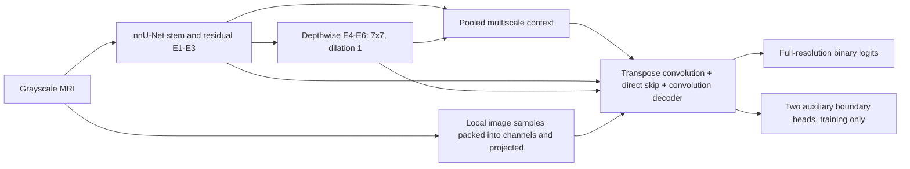

> Historical document from before the 2026-11-03 reorganization. Commands, results and relative paths describe the original workspace. Use the current [README](../../../README.md) for supported commands and retained artifacts.

# nnU-Net + BiRef + EMA skips and glioma policy

The current default is **`biref-ema`**: the BiRef backbone below, Efficient Multi-Scale Attention on E3/E4/E5 decoder skips, glioma-only augmentation and an asynchronous CPU policy-gradient controller for augmentation strength/sampling frequency. It has **8,858,988 segmentation parameters**; a batch-32, 256x256 AdamW/AMP/weight-EMA check measured **7.38 GB peak reserved memory**. The **10M parameter / 10 GB PyTorch reserved-memory limits remain active**.

See [EMA_RL.md](EMA_RL.md) for the full design, dedicated reward split, controller state/reward definition, commands and ablations. Start a fresh run with `.\run.bat --output runs\biref_ema_rl_seed2026`; no full training was launched during implementation.

## BiRef backbone and previous baseline

`biref` is the previous baseline, selected explicitly with `--variant biref`. `nnUNetBiRef` retains the nnU-Net residual stem, E1-E3 blocks, deep depthwise stages, direct skips and five convolution decoder stages. It adds compact localization context and image-detail references, plus mask-boundary supervision during training. This is an independently implemented BiRefNet-inspired adaptation for grayscale MRI, using the project's BRISC trainer. It imports no RMBG code or pretrained weights, KAN, SAM, Swin or deformable-convolution extension. The sections below describe this baseline; [EMA_RL.md](EMA_RL.md) describes the new additions and data protocol.

The model has **8,856,396 unique parameters**, including all segmentation and auxiliary boundary heads. The constructor and training entry point enforce **10,000,000 parameters maximum**. The EMA copy is included in memory measurements but is not counted as a second network.

## Data flow



| Part | Implementation |
|---|---|
| Encoder | Widths `[32,64,128,256,320,320]`; residual E1-E3 depths `[1,3,4]`; E4-E6 each has a strided 3x3 transition and two pointwise-depthwise-pointwise residual blocks |
| Spatial sampling | Default depthwise 7x7, dilation `(1,1)`, padding `(3,3)`; no blanket dilation-3 branch at the 8x8 bottleneck |
| Context | E3-E6 maps are pooled to bottleneck size and projected to 16 channels each; a 16-channel global descriptor is concatenated and projected back through a scaled residual |
| Detail references | At D3/D2/D1, adjacent input pixels are packed with factors 4/2/1 and projected through eight-channel branches; a scaled additive correction preserves the region path |
| Boundary heads | Eight-channel projections at D3 and D2 predict contours derived from the annotated binary masks; heads are evaluated only in training |
| Decoder | Original nnU-Net ConvTranspose2d, concatenated direct skips and convolution fusion; five logit heads for deep supervision |

Context and detail residual scales start at 0.01. Image references use **local pixel-unshuffle**, rather than RMBG's nonlocal patch stacking. Boundary supervision uses **mask contours**, rather than RMBG's Laplacian image-gradient targets. Decoder features are not multiplied by a suppressive edge gate. The design rationale and observed failure modes are in [RMBG2_REVIEW.md](RMBG2_REVIEW.md).

Input is `[B,1,H,W]`, with both dimensions at least 64 and divisible by 32; rectangular inputs are supported. Targets are binary tumor/background, with letterbox pixels `-1` ignored. Glioma scores group images by their image-level tumor label.

## Training changes

- Region loss remains CE + per-image foreground Dice, with normalized multiscale weights.
- Two auxiliary boundary losses add balanced BCE + soft Dice, averaged across heads and multiplied by `--boundary-weight` (default 0.1). Contours are formed at target resolution before max-pooling to head size. Invalid pixels, image perimeters and neighborhoods touching letterbox borders are excluded.
- `--augmentation robust` adds centered scaling, gamma, blur, Gaussian noise and simulated low resolution to the existing flip, rotation and intensity changes. Geometric transforms that remove more than approximately 3% of expected lesion area fall back to the original pair. There are no random crops. Validation and testing remain deterministic.
- AdamW, cosine decay, AMP, gradient clipping and the EMA warmup formula are retained. The new variant applies EMA **once per unique tensor**: the network library publishes aliases under multiple state-dict names. Older variants retain their original update behavior for checkpoint compatibility. This protocol is stored in EMA checkpoints.
- The selected checkpoint maximizes **validation glioma mIoU**, targeting at least 0.80. The supplied test split is used after checkpoint selection.

The new training run is an experiment, not an established accuracy improvement. Architecture, dilation, augmentation and EMA handling changed; the ablations below separate their effects. It is not the full nnU-Net v2 automatic planning/preprocessing/training pipeline. The auxiliary dictionary output needs this project's loss; do not substitute it into a stock nnU-Net trainer without adapting that trainer.

## Run it yourself

```powershell
.\run.bat --variant biref --output runs\biref_repeat_seed2026
.\run.bat --variant biref --resume runs\biref_repeat_seed2026\last.pt
.\run.bat --variant biref --evaluate-only --resume runs\biref_repeat_seed2026\best.pt
```

Defaults: 50 epochs, batch 32, size 256, workers 8, seed 2026, AdamW learning rate 0.001, weight decay 0.0001, AMP, NCHW and CUDA cuDNN tuning. No full training job was started during implementation. Use a fresh output folder; old depthwise checkpoints cannot be resumed into `biref`.

## Memory budget and measured check

Parameter count does **not** determine VRAM by itself. Input size, batch size, retained activations, optimizer, precision, EMA and convolution workspaces matter. At batch 32, 256x256 on the local RTX 3060, a bounded three-step check with actual `train_epoch`, AdamW, AMP, EMA, all deep-supervision heads and boundary loss measured approximately **6.26 GB allocated / 6.85 GB reserved** by PyTorch. This includes the student, EMA, gradients, optimizer state and activations. It excludes CUDA context and other applications, and is not an accuracy result or full-run memory guarantee.

Training checks peak reserved memory after updates and validation forward passes. It warns above 90% of `--max-vram-gb` and stops if that budget is exceeded; the default is **10 decimal GB**, and the option can lower it. The check detects a peak after allocation; CUDA can still raise an out-of-memory error during an allocation. Reduce batch size or input size if necessary. Old models exceeding 10M parameters remain available for read-only evaluation, but training is capped.

```powershell
python -m analysis.profile_training --variant biref --size 256 --batch-size 32 --steps 3 --output architecture/measurements/biref_b32_adamw_ema.json
```

Raw measurement: [biref_b32_adamw_ema.json](measurements/biref_b32_adamw_ema.json). This command performs bounded synthetic updates and exits; it does not launch dataset training.

## Controlled ablations

Keep variant `biref`, dilation 1, the same saved split procedure, batch size, budget, seed and unique-tensor EMA protocol across these runs. Start separate output folders for every run.

| Experiment | Extra options |
|---|---|
| Convolution control | `--augmentation legacy --no-biref-context --no-biref-detail --no-biref-boundary` |
| Generalization changes only | `--no-biref-context --no-biref-detail --no-biref-boundary` |
| Add context | `--no-biref-detail --no-biref-boundary` |
| Add image details | `--no-biref-boundary` |
| Full candidate | Defaults |

All model switches, kernel/dilation, augmentation and loss settings are saved and validated on resume. Use `--augmentation legacy` for an architecture-only comparison. Prior models are available with explicit `--variant depthwise` or KAN variants; see [DEPTHWISE.md](DEPTHWISE.md) and [LEGACY_KAN.md](LEGACY_KAN.md).

## Verification

Tests exercise rectangular training/inference, checkpoint round trips, nonzero gradients through context/detail/boundary paths, padding-aware contour supervision, parameter and memory guards, CUDA AMP updates, legacy defaults and lesion-retention fallback. A real-data CUDA smoke run exercises checkpoint selection, native-coordinate evaluation, metric reporting and efficiency profiling; its reduced-data scores are not accuracy results.

```powershell
python -m pytest src/tests architecture/tests -q
.\run.bat --smoke-test
```
