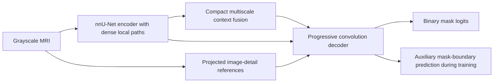

> Historical document from before the 2026-11-03 reorganization. Commands, results and relative paths describe the original workspace. Use the current [README](../../../README.md) for supported commands and retained artifacts.

# Glioma error audit and RMBG-2.0 architecture review

Inspected 2026-11-01. This review adds analysis artifacts only. The training architecture, weights, split assignments and run reports have not been modified. No training job was launched.

## Main finding

The reported 0.79 is **test Weighted mIoU 0.793776**, not glioma mIoU. The saved `depthwise7_seed2026` run selected epoch 23 by validation glioma mIoU. Its results are:

| Tumor group | Training slices | Validation mIoU | Test mIoU |
|---|---:|---:|---:|
| Glioma | 917 | 0.690638 | 0.662226 |
| Meningioma | 1,063 | 0.886242 | 0.894890 |
| Pituitary | 1,166 | 0.806085 | 0.802019 |

These are per-image foreground IoUs, grouped by filename tumor type. The network predicts binary background/tumor masks. It has no separate glioma pixel class or glioma-specific output head. Three-class CE weighting would not directly apply to this model; tumor-type balancing would require an image sampler or per-image loss weighting.

The image-count difference is modest, and count alone does not establish the reason for the gap. Slice counts also do not establish independent patient counts; reliable patient identifiers are unavailable.

## Read-only validation audit

The exact selected EMA checkpoint was loaded into the current model with strict state-dict matching. Evaluation was repeated on all 787 validation images, and on a seeded random subset of 120 training glioma images with augmentation disabled. Recomputed class mIoUs differ from the saved values by less than 0.00001.

For the selected checkpoint, validation glioma has:

- Pooled pixel recall **0.7550**, precision **0.8441**.
- **40 of 230** images with IoU below 0.5.
- Axial/coronal/sagittal mIoU **0.6738 / 0.6933 / 0.7075**.
- IoU **0.6928** for lesions occupying less than 1% of the image, **0.6943** for 1–5%, and **0.6184** for at least 5% (only 10 cases in the last bin).

The overlays include predictions at entirely different locations from the annotation, as well as partially missed regions and contour errors. This is more than a boundary-smoothing issue. The audit does not establish whether particular annotations are correct; cases with large disagreement deserve manual review before attributing every error to the model.

At epoch 50, on the same training subset and all 230 validation glioma images:

| Weights | Training subset mIoU | Validation mIoU |
|---|---:|---:|
| Student | 0.850617 | 0.683251 |
| EMA | 0.849570 | 0.684099 |

This supports a substantial generalization problem. More epochs improved training performance without improving validation, and the student/EMA comparison does not implicate EMA as the main cause. The training estimate uses 120 images, not the full training set.

A mask-only native → 256-grid → native roundtrip gives mean glioma IoU **0.9588**. This is a geometric reference, not a theoretical accuracy ceiling, and does not measure MRI texture lost by resizing. It suggests label-grid quantization alone is insufficient to explain the observed gap. Higher-resolution image input remains a separate experiment.

Existing test CSVs were used for descriptive error auditing only: test glioma recall is 0.7474, precision 0.8352, and 62/254 images have IoU below 0.5. Subsequent architecture selection should use validation rather than these test results.

## A concrete weakness in the current convolution design

At input size 256, E4/E5/E6 feature sizes are 32/16/8. The requested 7x7, dilation-3 convolution spans 19x19 coordinates. With zero padding, the average fraction of taps reading actual feature pixels is:

| Feature size | In-bounds taps | Padding taps |
|---|---:|---:|
| 32x32 | 70.44% | 29.56% |
| 16x16 | 46.05% | 53.95% |
| 8x8 | 15.43% | 84.57% |

At 8x8, offsets of ±9 are never in bounds, so 24 of the 49 kernel positions never sample an actual feature pixel anywhere in that stage. Other convolution paths still supply local information. This is an architectural inefficiency and a plausible weakness, not proof that dilation caused the accuracy plateau. The previous 3x3 model also plateaued near 0.685 validation glioma mIoU.

A useful control is 7x7/dilation-1 at the same training settings. For an architectural revision, retain a dense local spatial path and use stage-appropriate context rather than uniform large dilation at all deep stages.

## What the actual RMBG-2.0 implementation does

Authenticated read access succeeded. The downloaded source is pinned to revision **2fd7b4b0f2393ddb39a267fb62df6c010928a6c6**, with source metadata in [source.json](../storage/reference/RMBG-2.0/2fd7b4b0f2393ddb39a267fb62df6c010928a6c6/source.json). The credential was not saved to project files. Pretrained weights were not downloaded or executed; the code and configuration were inspected directly.

The [model card](https://huggingface.co/briaai/RMBG-2.0) identifies BiRefNet as its architecture. The [exact gated source](https://huggingface.co/briaai/RMBG-2.0/blob/2fd7b4b0f2393ddb39a267fb62df6c010928a6c6/birefnet.py) selects:

- **Swin-L encoder**, with original and half-size input features concatenated at four scales.
- Encoder context gathered across scales and squeezed before reconstruction.
- **Inward reference:** source-image patches are stacked along channels and projected into decoder stages, providing direct image detail.
- **Outward reference:** gradient-prediction branches and learned gates guide decoder features; auxiliary supervision is used during training. Inference generates its gates from features without ground-truth masks.
- Decoder blocks using **deformable multi-branch context**, lateral feature fusion and multiscale predictions.

These ideas are explained in the [BiRefNet paper](https://arxiv.org/html/2401.03407v7). The downloadable source differs in details from the paper and from the current upstream GitHub version; the pinned implementation is the basis for the list above. In particular, its gradient targets use Laplacian image features multiplied by intermediate mask predictions. This is not simply an auxiliary binary mask-boundary loss.

The embedded configuration contains BCE, IoU and SSIM weights, but BRIA's complete proprietary training recipe is not established by this inference repository. Do not assume the embedded defaults reproduce its original training.

RMBG uses RGB natural images and an example input resolution of 1024; our pipeline uses grayscale MRI at 256. Its background-removal scores do not predict glioma performance. The file named `diagram1.png` is a benchmark comparison chart, not an architecture diagram.

## Proposed nnU-Net adaptation

The useful direction is separate localization and detail reconstruction. An inference from the audit is that localization deserves at least as much attention as boundary refinement. A compact candidate would be:

1. Preserve the nnU-Net encoder interface, direct skips and binary output. Supply local features at every stage; use large/context kernels only where feature-map support makes sense.
2. Add compact context fusion for coarse localization, without copying the full Swin-L/two-input backbone into a randomly initialized small-data experiment.
3. Add original-image detail references to late decoder stages. Grayscale channels, rectangular inputs and ignored letterbox pixels need explicit handling.
4. Test auxiliary **mask-boundary** supervision as an adaptation to MRI, not an exact reproduction of RMBG's image-gradient targets. Strong anatomy edges need not coincide with the annotated tumor boundary. Maintain a direct region path so an edge gate cannot suppress all lesion evidence.

A larger decoder alone may worsen the observed generalization gap. The current augmentation uses horizontal flips, ±10-degree rotation and mild linear intensity changes; it is much narrower than [the local nnU-Net v2 augmentation pipeline](../repo/nnunet/nnunetv2/training/nnUNetTrainer/nnUNetTrainer.py), which includes scaling, noise, blur, gamma and simulated low resolution. Appropriate augmentation and a pretrained-feature control should be tested alongside architecture ideas, as separate factors.

## Experiments that separate the possible causes

Keep exact split assignments and validation glioma checkpoint selection. Do not optimize thresholds or architecture on the supplied test split.

1. **Control:** current model with dilation 1, same batch/epoch/optimizer settings. This isolates the overly sparse spatial branch.
2. **Generalization:** add appropriate scaling, gamma/contrast, noise/blur and low-resolution variation independently of a decoder change. Avoid introducing crops that silently remove the tumor target. Tumor-type-balanced sampling is a separate ablation.
3. **Architecture:** introduce compact context fusion, then image-detail references, then auxiliary boundary supervision. Measure each increment, including parameter count and memory.
4. **Resolution/pretraining:** compare 512 input and pretrained encoder features separately. Neither is guaranteed to improve the result; the current audit does not identify one as the sole missing ingredient.

For every experiment, report validation glioma recall/precision, number of large misses, train–validation gap, and surface metrics as well as mIoU. An improvement in boundary appearance without fewer localization failures will not resolve the present deficit.

## Reproducible artifacts

- [diagnose_glioma.py](../analysis/diagnose_glioma.py): read-only validation/checkpoint audit and plot generation.
- [diagnosis.json](../storage/analysis/depthwise7/diagnosis.json): selected-checkpoint counts and diagnostics.
- [last_checkpoint_comparison.json](../storage/analysis/depthwise7/last_checkpoint_comparison.json): epoch-50 student/EMA comparison.
- [Validation overlays](../storage/analysis/depthwise7/validation_glioma_examples.png): worst, quartiles and best examples.
- [Validation per-image CSV](../storage/analysis/depthwise7/validation_per_image.csv).
- [Exact RMBG source](../storage/reference/RMBG-2.0/2fd7b4b0f2393ddb39a267fb62df6c010928a6c6/birefnet.py).

Reproduce the selected-checkpoint audit from the project root with `python -m analysis.diagnose_glioma --run runs/depthwise7_seed2026`. This performs inference only.
